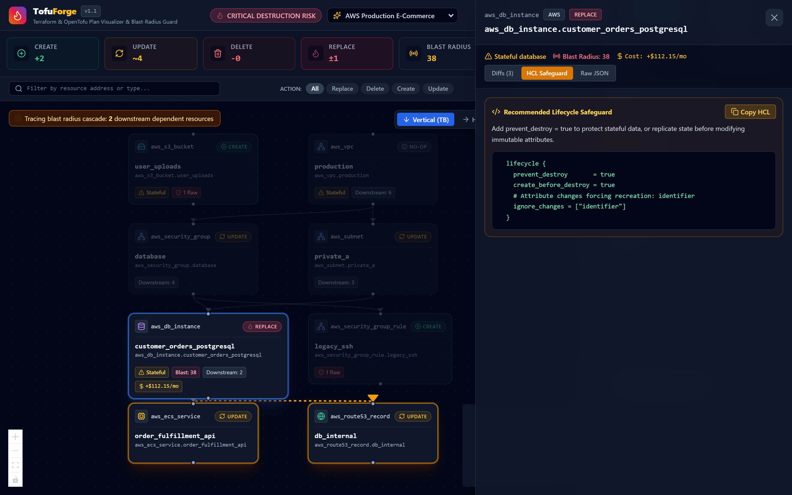
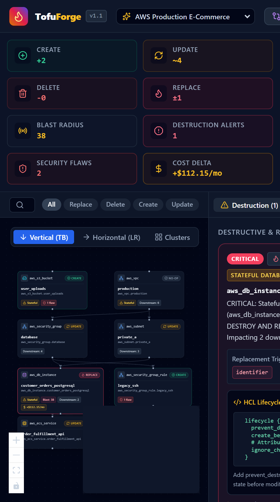

<div align="center">


# TofuForge

**Interactive Terraform and OpenTofu Plan Visualizer, Blast-Radius Inspector, and Resource Destruction Guard**

[](https://go.dev/)
[](https://react.dev/)
[](https://opentofu.org/)
[](https://www.terraform.io/)
[](LICENSE)

<p align="center">
  <a href="#overview">Overview</a> •
  <a href="#key-capabilities">Key Capabilities</a> •
  <a href="#quickstart">Quickstart</a> •
  <a href="#cli-reference">CLI Reference</a> •
  <a href="#plan-to-plan-diff">Plan Diff Engine</a> •
  <a href="#pre-flight-security-rules">Security Rules</a> •
  <a href="#policy-configuration">Policy Config</a> •
  <a href="#ci-cd-integration">CI/CD Gating</a>
</p>

</div>

---

## Interactive Demo

<div align="center">
  
</div>

---

## Overview

Terraform and OpenTofu execution plans often exceed several thousand lines of terminal text. During pull request reviews, engineers routinely overlook critical lines such as `~ forces replacement`, which can silently destroy and recreate production databases, route tables, or VPC subnets.

TofuForge is a single-binary static analysis engine and interactive visual studio designed to prevent catastrophic infrastructure deployments before `apply`:
1. Ingests raw JSON plan files (`terraform show -json` and `tofu show -json`).
2. Builds an explicit and implicit dependency directed acyclic graph (DAG).
3. Computes downstream blast radius for every resource scheduled for destruction or recreation.
4. Estimates cloud cost deltas across compute, storage, and database tiers.
5. Audits pre-flight security and tagging rules across AWS, GCP, Azure, and Kubernetes.
6. Compares consecutive plan revisions (`tofuforge diff`) to verify remediated risks.
7. Produces self-contained offline HTML reports and compact GitHub PR comment summaries.
8. Serves an interactive React 19 web studio with real-time cascade tracing.

---

## Visual Studio Interface

<div align="center">
  
</div>

<br/>

<div align="center">
  
</div>

<br/>

<div align="center">
  
</div>

<br/>

<div align="center">
  
</div>

---

## Key Capabilities

- **Universal Plan Support**: Works across all major cloud providers (AWS, Google Cloud, Microsoft Azure, Kubernetes) with standard JSON plan outputs from Terraform 0.12+ and all OpenTofu versions.
- **Blast-Radius DAG Engine**: Traces transitive downstream dependencies using breadth-first traversal. Computes a cumulative risk score that factors resource statefulness and dependency depth.
- **Destruction & Recreation Guard**: Flags database instances, object storage buckets, encryption keys, and virtual networks undergoing replacement with high-visibility alerts.
- **HCL Lifecycle Safeguards**: Automatically generates copyable HCL blocks (`prevent_destroy = true`, `create_before_destroy = true`) directly within destruction alerts.
- **Cloud Cost Guard**: Calculates monthly before/after costs and delta figures for provisioned virtual machines, databases, and disks.
- **Plan Revision Comparison**: Evaluates deltas between base and target plan revisions, verifying when destructions are eliminated.
- **Standalone Offline HTML Reports**: Bundles the full React 19 visual studio into a single zero-dependency HTML file suitable for air-gapped archives or CI artifacts.
- **Pre-Flight Security & Tagging**: Detects open ingress rules, unencrypted disks and buckets, wildcard IAM policies, and enforces mandatory governance tags.

---

## Quickstart

### 1. Installation

Build directly from source:
```bash
git clone https://github.com/alexandrmotologa/tofuforge.git
cd tofuforge
go build -o tofuforge ./cmd/tofuforge
```

### 2. Generate a Plan JSON

Using OpenTofu:
```bash
tofu plan -out=tfplan.binary
tofu show -json tfplan.binary > tfplan.json
```

Using Terraform:
```bash
terraform plan -out=tfplan.binary
terraform show -json tfplan.binary > tfplan.json
```

### 3. Inspect in Terminal

Run pre-flight checks and view a colorized analysis report:
```bash
./tofuforge inspect tfplan.json
```

Or pipe directly from stdin:
```bash
tofu show -json tfplan.binary | ./tofuforge inspect -
```

### 4. Launch Interactive Web Studio

Launch the embedded visual studio:
```bash
./tofuforge serve tfplan.json --open
```
Navigate to `http://localhost:8080` to explore the DAG, trace cascading impact, and inspect attribute before/after diffs.

---

## CLI Reference

### `tofuforge inspect [plan.json]`
Evaluates changes, scores blast radius, checks security policies, calculates cost deltas, and executes CI gates.

```bash
# Basic inspection
tofuforge inspect tfplan.json

# Export analysis as JSON
tofuforge inspect tfplan.json --json

# Generate PR comment markdown file
tofuforge inspect tfplan.json -o pr-comment.md

# Load custom governance policy
tofuforge inspect tfplan.json -c .tofuforge.yaml

# CI Gating: Fail if any resource is deleted or replaced
tofuforge inspect tfplan.json --fail-on-destructive

# CI Gating: Fail if stateful resources (databases, storage) undergo recreation
tofuforge inspect tfplan.json --fail-on-critical

# CI Gating: Fail on critical security flaws
tofuforge inspect tfplan.json --fail-on-security

# CI Gating: Fail if cumulative blast radius exceeds threshold
tofuforge inspect tfplan.json --max-blast-radius 25

# CI Gating: Fail if monthly cost delta exceeds budget limit
tofuforge inspect tfplan.json --max-cost-delta 100.0
```

### `tofuforge diff [base.json] [target.json]`
Compares two plan revisions to verify resolved destruction risks and track security regressions.

```bash
tofuforge diff prior_plan.json fixed_plan.json
```

### `tofuforge report [plan.json]`
Generates a standalone, self-contained single-file HTML visualizer report that works completely offline.

```bash
tofuforge report tfplan.json -o tofuforge-report.html
```

### `tofuforge pr-comment [plan.json]`
Outputs a clean Markdown report formatted for GitHub and GitLab pull request comments.

```bash
tofuforge pr-comment tfplan.json
```

### `tofuforge serve [plan.json]`
Starts the embedded web studio HTTP server.

```bash
tofuforge serve tfplan.json --port 8080 --host localhost
```

---

## Plan-to-Plan Diff

When updating infrastructure code to fix accidental recreation, developers can compare the initial plan against the revised plan using `tofuforge diff`:

```
================================================================================
                    TOFUFORGE PLAN REVISION COMPARISON                          
================================================================================
Blast Radius Score Delta:  -38 (Prior: 38 -> Current: 0)
Critical Alerts Delta:      -1
Security Flaws Delta:       -2

[RESOLVED DESTRUCTIONS]:
  ✓ aws_db_instance.customer_orders_postgresql - no longer marked for replace

[RESOLVED SECURITY FINDINGS]:
  ✓ AWS-SEC-001: Security Group Ingress Allows Public SSH (Port 22)
  ✓ AWS-SEC-003: S3 Bucket Missing Server-Side Encryption Configuration

[ACTION TRANSITIONS]:
  • aws_db_instance.customer_orders_postgresql: replace -> update
================================================================================
```

---

## Pre-Flight Security Rules

| Provider | Rule ID | Title | Severity |
| :--- | :--- | :--- | :--- |
| **AWS** | `AWS-SEC-001` | Security Group allows public ingress on sensitive ports (22, 3389, 5432, 3306) | `CRITICAL` |
| **AWS** | `AWS-SEC-002` | Security Group ingress permits unrestricted internet traffic (all protocols/ports) | `CRITICAL` |
| **AWS** | `AWS-SEC-003` | S3 bucket missing server-side encryption configuration | `HIGH` |
| **AWS** | `AWS-SEC-004` | RDS database instance is publicly accessible | `CRITICAL` |
| **AWS** | `AWS-SEC-005` | RDS database storage encryption is disabled | `HIGH` |
| **AWS** | `AWS-SEC-006` | IAM policy contains wildcard actions (`*`) | `HIGH` |
| **AWS** | `AWS-SEC-007` | EBS volume encryption is disabled | `MEDIUM` |
| **GCP** | `GCP-SEC-001` | Compute firewall allows public ingress to administrative or database ports | `CRITICAL` |
| **GCP** | `GCP-SEC-002` | Cloud SQL instance has public IPv4 with 0.0.0.0/0 authorized network | `CRITICAL` |
| **GCP** | `GCP-SEC-003` | IAM policy grants roles to public internet (`allUsers` or `allAuthenticatedUsers`) | `CRITICAL` |
| **GCP** | `GCP-SEC-004` | Cloud Storage uniform bucket-level access is disabled | `MEDIUM` |
| **Azure** | `AZR-SEC-001` | NSG inbound rule allows internet traffic to sensitive ports | `CRITICAL` |
| **Azure** | `AZR-SEC-002` | Storage account allows unencrypted HTTP traffic | `HIGH` |
| **Azure** | `AZR-SEC-003` | Storage account public blob access is enabled | `HIGH` |
| **Azure** | `AZR-SEC-004` | MSSQL database transparent data encryption is disabled | `HIGH` |
| **K8s** | `K8S-SEC-001` | Container runs in privileged mode | `CRITICAL` |
| **K8s** | `K8S-SEC-002` | Container does not enforce non-root execution | `HIGH` |
| **K8s** | `K8S-SEC-003` | Workload container missing CPU or memory resource limits | `MEDIUM` |
| **Governance** | `TAG-SEC-001` | Resource missing mandatory organizational governance tags | `HIGH` |

---

## Policy Configuration

Create a `.tofuforge.yaml` file to customize linting rules and enforce tagging standards:

```yaml
version: 1

rules:
  # Rule IDs to ignore across checks
  ignore:
    - "AWS-SEC-007"

  # High-priority rules that trigger strict failure
  strict_rules:
    - "AWS-SEC-001"
    - "GCP-SEC-001"

# Mandatory tags required for every taggable resource
mandatory_tags:
  - "Environment"
  - "Owner"
  - "CostCenter"
```

---

## CI/CD Gating Example

```yaml
name: TofuForge Safety Check

on:
  pull_request:
    branches: [main]

jobs:
  audit-plan:
    runs-on: ubuntu-latest
    steps:
      - uses: actions/checkout@v4
      - uses: opentofu/setup-opentofu@v1
      - uses: actions/setup-go@v5
        with:
          go-version: '1.23'

      - name: Install TofuForge
        run: go install github.com/alexandrmotologa/tofuforge/cmd/tofuforge@latest

      - name: Generate Plan
        run: |
          tofu init
          tofu plan -out=tfplan.binary
          tofu show -json tfplan.binary > tfplan.json

      - name: Inspect Plan & Block Dangerous Destructions
        run: |
          tofuforge inspect tfplan.json \
            --fail-on-critical \
            --fail-on-security \
            --max-cost-delta 200 \
            -o pr-summary.md

      - name: Post Comment to PR
        if: always()
        uses: actions/github-script@v7
        with:
          script: |
            const fs = require('fs');
            if (fs.existsSync('pr-summary.md')) {
              const body = fs.readFileSync('pr-summary.md', 'utf8');
              github.rest.issues.createComment({
                issue_number: context.issue.number,
                owner: context.repo.owner,
                repo: context.repo.repo,
                body: body
              });
            }
```

---

## License

This project is licensed under the MIT License. See [LICENSE](LICENSE) for details.
